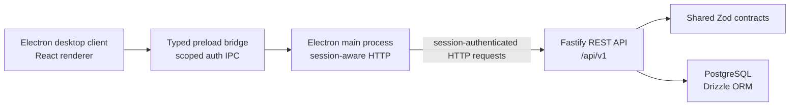

# Architecture

## Request and Data Flow

The desktop renderer is an untrusted UI boundary. Its BrowserWindow enables context isolation and sandboxing, disables Node integration, and exposes no unrestricted IPC. The typed preload bridge exposes authentication, plan/subscriber/service-account management, billing, invoice payment history, and a paginated payment feed. Each IPC handler checks that calls originate from the trusted main frame and validates inputs with shared schemas. Main-process `net.fetch` uses the default Electron session and `credentials: 'include'`, so the API's HttpOnly cookie remains in Chromium's cookie store rather than renderer storage. Unauthorized API responses notify the renderer so an expired session returns to sign-in. Renderer code must not import database libraries or connect to PostgreSQL.

## Responsibilities

- `apps/desktop`: Electron main/preload processes and the React renderer. Business and authentication requests are mediated by validated IPC and sent from the main process to the API; the renderer has no direct database access.
- `apps/api`: Fastify authentication, authorization, business-management and billing routes; request logging; validation; services; and PostgreSQL access through Drizzle and `pg`.
- `packages/shared`: Zod schemas and TypeScript contracts safe to share between client and server.
- `database/migrations`: Drizzle-generated migrations. The initial authentication data-model migration is generated but is not applied automatically.
- `database/seeds`: reserved for synthetic business data; authentication development setup is an explicit API workspace command.

## Authentication Data Model

The API schema defines users, roles, permissions, user-role assignments, role-permission assignments, revocable expiring server-side sessions, and PostgreSQL-backed login rate-limit buckets. Role names and permission keys are constrained centrally. Migrations and API startup do not seed roles, permissions, users, or administrator accounts. The explicit `npm run db:seed:dev` command provisions the four defined roles, the Phase 3 permissions, and a demo Administrator only in `bcis_db`, using credentials supplied through temporary environment variables. Session storage is designed for a hash of a random token, not the raw token. The generated schema migrations are not applied automatically; apply the authentication and rate-limit migrations before using those database-backed endpoints.

Shared Zod contracts cover login input, safe authenticated-user details (including granted permission keys), business entities, invoices, payments and report queries. Password hashing uses Argon2id in the API. The API provides login, logout, and current-user endpoints using opaque random session tokens whose SHA-256 hashes alone are stored, with a 12-hour absolute expiry and server-side revocation. Authentication is separate from authorization; business routes check explicit permissions on the server, and the desktop uses the same permission keys to hide unavailable navigation and mutation controls.

The session is carried in an HttpOnly, host-only, SameSite=Strict cookie. Production uses a Secure `__Host-` cookie; development uses a non-Secure cookie, and the auth endpoints reject non-loopback clients. Development authentication is intended only for localhost and the API's default loopback binding. Do not expose the development API or cookie transport to an untrusted network. Login attempts are limited by PostgreSQL-backed atomic fixed-window counters for both source IP and a hash of the normalized identifier plus IP; no raw identifiers or IP addresses are persisted by the limiter. The limiter is shared across API processes using the same database. Same-origin checks protect state-changing cookie requests; no CORS policy or trust-proxy behavior is enabled. Desktop login, current-user loading, and logout use constrained Electron IPC and the default session's HTTP cookie jar; raw session tokens are never exposed to the renderer.

## Health and Database Checks

`GET /api/v1/health` reports application health without contacting PostgreSQL. `GET /api/v1/health/database` performs a separate `select 1` connectivity check and returns `503` when the database cannot be reached. The API validates `DATABASE_URL` at startup but does not require the database to be reachable to serve its application health route.

## Development Setup and Limits

Use Node.js 22.12 or newer, run `npm install` from the repository root, and copy `.env.example` to `.env`. Set `DATABASE_URL` to an authorized PostgreSQL instance. The default API host is loopback (`127.0.0.1`); exposing the service to office PCs requires deliberate host, firewall, and deployment configuration. No database or credentials are created by this repository.

Dashboard totals reuse paginated entity counts and the billing summary. Payments use a paginated read-only feed joined to invoice snapshots. Collections reuse the invoice outstanding-balance filter. Monthly reports reuse the billing summary and invoice list, and CSV export is generated locally from those API responses. Do not place customer data or secrets in the repository.

## Administration, lifecycle, and operations

`/api/v1/admin/users` and `/api/v1/admin/roles` are protected by explicit `users.read`, `users.manage`, `roles.manage`, and `permissions.manage` checks. Passwords are Argon2id hashes, API user projections omit password hashes, callers cannot grant permissions they do not hold or change their own access, and transactional role/status updates preserve at least one active account with the complete administration permission set. Role assignment permission checks run under the same advisory lock as role-permission updates. Disabling an account revokes its unexpired sessions. Existing roles are fixed by the schema; arbitrary role creation is not supported.

Plans, subscribers, and service accounts can be hard-deleted only by their manage permission. PostgreSQL foreign keys reject deletion when the record has dependent service accounts or invoice history; no billing records are cascade-deleted. Plans and service accounts retain their existing disable/suspend/cancel lifecycle fields. The subscriber schema has no soft-delete status.

The renderer chooses an API origin through a constrained preload IPC call. The main process checks the current server-issued `permissions.manage` grant, permits HTTPS or loopback HTTP only, validates `/api/v1/health`, then atomically stores the endpoint in Electron's user-data directory. The setting applies to authentication, business, and administration clients, and endpoint changes require login again. Renderer permission flags only affect control visibility; the IPC handler and API remain authoritative.

Operator commands `npm run db:backup --workspace=@bcis/api` and `npm run db:restore --workspace=@bcis/api -- <absolute-archive-path>` use PostgreSQL client tools without executing from the application UI. On Windows they prefer the standard PostgreSQL 17 install directory and otherwise rely on `PATH`. Backups live outside the repository by default and archives are checked with `pg_restore --list`. Restore prompts for the exact target database name and exits on the first restore error within its single transaction. Neither command is part of startup or testing; administrators remain responsible for tested recovery procedures and secure backup retention.
